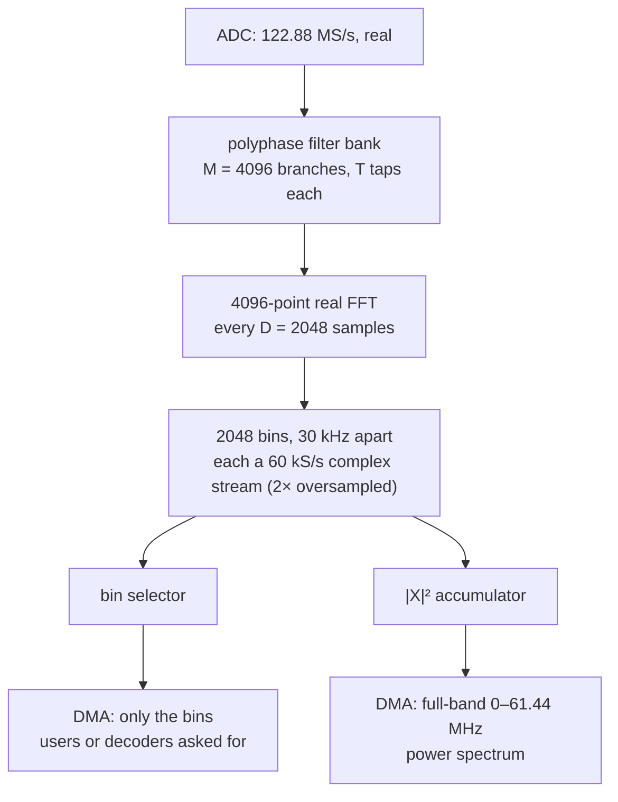
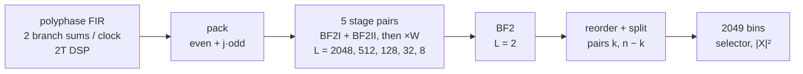

# Channelizer bitstream (design note)

Status: **in progress** (2026-10-28): software model done, FFT
architecture chosen (§3.6), the Verilog datapath (polyphase FIR, FFT,
split) bit-exact to the model in simulation; synthesis for resources and
timing under way (§5). This would be the core of the open-FPGA
milestone (server design §11, M6).
It drops compatibility with the stock server's FPGA interface. The
stock bitstream stays usable as a fallback with its own backend.

## 1. Why

Today, stock and open alike, every RX channel is a tuned receiver at the
full ADC rate: NCO, two multipliers and a first CIC, then decimation.
That costs about 2 DSP48 slices and a block of LUTs per channel before
any rate reduction.

| design | RX channels | LUT | DSP | BRAM36 | timing |
|---|---|---|---|---|---|
| vendor HF | 12 (13 VHF) | 84 % | 75 % | 55 % | met |
| open HF (`fpga/`) | 12 | 68 % | 71 % (57) | 21 % | met at 122.88 MHz with 0.06 ns to spare beyond a 0.4 ns guard |

With 80 DSP and 17.6 k LUTs, that architecture tops out at roughly 16–20
channels, and each channel makes timing harder. The waterfall is two more
tuned receivers whose I/Q the CPU turns into spectra: our biggest CPU cost
(server `doc/m3-multi-user.md` §4).

## 2. The idea

One channelizer splits the whole band at once, and the CPU only finishes
the channels that are in use:

(The real FFT gives 2049 bins; the hardware drops the Nyquist bin, which
is real and half above fs/2, so a frame of 2048 clocks gives exactly 2048
bins, one per clock.)

* **Real input, no real→complex stage.** The filter bank works on the
  real ADC samples and the FFT is real-to-complex. Its band edges are at
  DC and Nyquist, as the ADC's are. A complex intermediate (fs/4 mix +
  half-band) would have put 0–3 MHz (LF/MF/160 m) into a transition band.
* **2× oversampling** (D = M/2) makes every bin flat to ±21 kHz. Each
  bin's output is the band around its centre, sampled at 60 kS/s, with
  everything beyond ±39 kHz rejected. So any channel up to ±6 kHz wide
  whose centre lies within ±15 kHz of a bin centre (always true for one
  bin) is entirely inside that bin. The phase correction for D = M/2 is
  a sign flip of odd bins on odd frames.
* **Per user, on the CPU:**
  * shift by the offset from the bin centre (at most ±15 kHz)
  * decimate 60 → 12 kS/s (the existing audio chain, ×5 instead of ×4)
  * HPSDR at 48 kS/s by a 4/5 resampler

  This is about the work done today per user on 48 kS/s.
* **Channels are limited by CPU and network, not the FPGA:** maybe 24–32
  users on two A9 cores after the planned NEON/decimator work. Bins cost
  60 kS/s × 8 bytes = 480 kB/s each; 64 bins are about 31 MB/s of DMA.
* **Full-band waterfall for free:** |X|² summed per bin over a line
  gives the whole 0–61 MHz at 30 kHz resolution, at any line rate. A
  zoomed view is a CPU zoom-FFT over the bins it covers: one bin per
  30 kHz of span, e.g. 17 bins for a 480 kHz view. That replaces the WF
  slots and their time-sharing.
* **Wide slices are adjacent bins:** CW/RTTY skimmers over 50–100 kHz,
  FT8 on every band, wideband I/Q export (a few MHz) for SDR++ or
  ka9q-radio.

Prior art: ka9q-radio (GPL) runs hundreds of channels from one large FFT
(fast convolution) on a PC with the RX-888; wsprdaemon builds on it.
Polyphase channelizers are standard on FPGAs (CASPER, radio astronomy).

## 3. Numbers

### 3.1 Measured with the float model (2026-10-23)

`cargo run --release -p web888-dsp --example pfbmodel` (server repo):
M = 4096, pass ±21 kHz, stop ±39 kHz. "Worst alias" is the strongest
stopband tone (39–150 kHz from the bin centre) that folds into the
passband, relative to the tone. Ripple is across ±21 kHz.

| T | design | worst alias | ripple |
|---|---|---|---|
| 8 | 90 dB | −52.5 dB | 0.021 dB |
| 9 | 90 dB | −70.1 dB | 0.003 dB |
| 10 | 90 dB | −90.5 dB | 0.0003 dB |
| 11 | 100 dB | **−101.2 dB** | 0.0001 dB |
| 12 | 110 dB | −112.0 dB | < 0.0001 dB |

The Web-888's ADC (LTC2208, 16 bit, about 77 dB SNR over 61 MHz) has a noise
floor near −121 dBFS in a 2.4 kHz SSB channel. A signal at −20 dBFS
aliased 100 dB down stays under it.
* **T = 11** (100 dB) is the default.
* **T = 10** (90 dB) is the fallback if BRAM runs short.

The design attenuation has to match T: asking for more than T taps can
give makes it worse (the 110 dB rows at T ≤ 11).

**Noise floor against today's chain** (`examples/chancompare.rs`): the
same ADC samples go through the channelizer (T = 11) and an exact model
of the FPGA RX chain (NCO, CIC N=3 R=256, CIC N=5 R=10,
`web888_iq::ddc`). The samples are white noise at the LTC2208's SNR
plus strong carriers at each path's worst aliasing offsets around six
FT8 dials (3.5–21 MHz). The table gives the USB 300–2700 Hz floor in dB
re full-scale sine:

| case | tuned chain | channelizer |
|---|---|---|
| noise only | −121.5 to −121.7 | −121.5 to −121.6 |
| + 36 carriers at −26 dBFS | +0.1 dB | ≤ +0.1 dB |
| + one carrier per dial at −10 dBFS, worst offset | +0.1 dB | **up to +2 dB** (+61.5 kHz; +1.5 dB in a transition-band case) |

So T = 11 equals today's chain for carriers up to about −20 dBFS. At
−10 dBFS (very strong for HF on this ADC) its aliases sit about 115 dB
down, right at the floor. **T = 12** (110 dB, measured −112) would close
that gap for 3 more BRAM, but the first synthesis (§5) needs 51.5 of 60
for the datapath alone at T = 11, so **T = 11** stays (the model and the
RTL use it).

The harness has to wait out the carriers' switch-on (200 ms, longer than
the audio filter's ~60 ms block); measuring earlier showed onset
splatter as a fake +30 dB floor.

**Per-user CPU** (`examples/bench.rs`, the `pfb fine stage` line, one A9
core at nice 19 on the production unit, three runs):

| path | per user |
|---|---|
| shift + USB chain from a 60 kS/s bin | **4.4–4.6 %** |
| today's USB chain from a 48 kS/s channel | 3.5–3.7 % |

About 25 % more, from the higher rate plus the shift. Two cores less the
server's other threads leave roughly 30 plain users, or about 25 with
NB/NR on, before the NEON/decimator work.

The waterfall's CPU cost goes away with this design: the full-band
power line comes from the FPGA, and zoom-FFTs run over a few bins.

BRAM: estimated at about 47 of 60 at T = 11 (§3.2) before the RTL
existed; the synthesised datapath uses 51.5 (§5). The first float-only
estimate (~43) assumed perfect packing.

### 3.2 Fixed-point widths (2026-10-23)

`crates/dsp/src/pfbfx.rs` models the integer datapath, sweeping widths
with `examples/pfbfxmodel.rs`. The 4096-point real FFT is done the FPGA
way: the real branch sums packed into 2048 complex values, a radix-2 FFT,
then a split stage. The model runs on the same 16-bit samples as the
float model and compares the two. The input is a tone at −1 dBFS or
eight tones near full scale, both with ADC noise of 3 LSB rms. The
measure is how far the fixed-point error stays below the ADC noise in a
bin (bins away from the tones).

| choice | error below noise (−1 dBFS tone / 8 tones) | saturations |
|---|---|---|
| 25-bit data, 18-bit twiddles, 18-bit coefficients, halving in all 11 stages | 13.8 / 16.5 dB | 0 |
| same, halving in 5–7 stages | — | yes (tone) |
| 22-bit data, best scaling | ≤ 9 dB | 0 |
| 25-bit data, 18-bit twiddles, 18-bit coefficients, halving 4 first + 4 last | 16.2 / 23.9 dB | 0 |
| **25-bit data, 18-bit twiddles, 20-bit coefficients, halving 4 first + 4 last** | **23.8 / 28.3 dB** | 0 |
| same with 22- or 25-bit coefficients | 25.3 / 28.8 dB | 0 |

* **Chosen** (`FixedSpec::recommended`):
  * 16-bit ADC samples on the DSP48 B port, 20-bit coefficients on A
  * branch sums exact (48-bit accumulators), rounded to 25-bit FFT data
  * 18-bit twiddles
  * a rounded halving after FFT stages 1–4 and 8–11
* The fixed-point error is then ~24 dB below the ADC noise, about +0.02
  dB on the floor. Nothing saturates for a −1 dBFS tone.
* At least 8 halvings are needed: fewer saturate on a near-full-scale
  tone. 16-bit twiddles cost 3–6 dB.
* Output: bins as 32-bit I/Q, scaled so a full-scale sine reads 2^29,
  like today's RX samples, so the server's `rx_to_c32` applies
  unchanged. The 25 significant bits fit easily.
* The table above was measured with the radix-2 arithmetic. The chosen
  Verilog FFT is radix-2², which rounds at other points; the model has
  it too (`FftArch::Radix22`, §3.6), with the same floor, and it is the
  reference for the bit-exact tests.

**BRAM recount** at T = 12 (before the RTL; the synthesised numbers are
in §5). A BRAM36 holds 2K×18, 16K×2 or 1K×36, so widths don't pack
perfectly:

| memory | layout | BRAM36 |
|---|---|---|
| sample history, 49 152 × 16 bit | 2K×18 | 24 |
| coefficients, 24 576 × 20 bit (symmetric half) | 2K×18 + 16K×2 | ~13.5 |
| FFT delay lines and twiddles, reorder buffer | | ~8 |
| power accumulator, DMA FIFOs | | ~5 |
| **total** | | **~50 of 60** |

At T = 11 it is about 47. That fits, but leaves little for extras.
Keeping the history in DDR doesn't work: every frame reads all M × T
samples, 22 × the input rate, about 5 GB/s.

### 3.3 On a real recording (2026-10-23)

`examples/pfbwav.rs` runs a HackRF recording (7.68 MS/s around 8.6 MHz,
40 m / 31 m / 41 m) through both paths:
* today's iq-backend chain: NCO, CIC to 480 kS/s, CIC R=10, audio chain
  at 48 kS/s
* the complex channelizer: `PfbComplex`, 256 branches, the same 30 kHz
  bins at 60 kS/s, then `PfbChannel`

The two outputs are compared after aligning delay, gain and carrier
phase, with fixed gain so the AGCs don't differ:

| channel | where in its bin | level | difference left |
|---|---|---|---|
| FT8 7074 kHz, USB | +4.2 kHz | equal | **−62.8 dB** (16-bit WAV limit) |
| AM 9540 kHz | +10.3 kHz | equal | −26.5 dB (400–3000 Hz) |
| AM 7300 kHz | −10.3 kHz | equal | −29.3 dB |

* The channelizer path is 2.7 samples (0.2 ms) earlier.
* Its carrier phase differs by a constant (−11.3° here). In SSB that is
  an inaudible all-pass phase.
* AM's envelope detection mixes the 3–5 kHz sidebands, where the two
  chains' filters differ slightly. The residual is audibly nothing, but
  worth a look when the audio filters are tuned.
* With AGC the levels agree within 0.2 dB and the spectra within
  ±0.3 dB per 500 Hz.

### 3.4 First estimates (before the model)

Prototype filter (Kaiser): pass ±21 kHz, stop ±39 kHz. The transition is
18 kHz at 122.88 MS/s = 1.46·10⁻⁴ cycles/sample; for 100 dB that needs
≈ 44 k taps, so **T ≈ 11 taps per branch**.

| block | DSP | BRAM36 | LUT | notes |
|---|---|---|---|---|
| polyphase FIR | ~24 | ~22 data + ~12 coeffs (symmetric) | ~2 k | 24 MAC per input sample (4096 × 11 per 2048 samples) |
| 4096-pt real FFT, streaming | ~15 | ~6 | ~3 k | as a 2048-pt complex FFT, 1 point/clock |
| power accumulator, bin selector, DMA | 2 | ~6 | ~2 k | |
| registers, PPS, DNA, GPIO (from `fpga/`) | 1 | 0 | ~1.5 k | |
| **total** | **~42** | **~46** | **~8.5 k** | of 80 DSP / 60 BRAM / 17.6 k LUT |

BRAM is the tight resource, more than first guessed: the delay lines hold
M × T input samples. Ways to trade it:
* 90 dB instead of 100 dB (T ≈ 10)
* narrower guaranteed passband (smaller channels near bin edges)
* 14-bit stored samples
* 18-bit coefficient symmetry
* DDR instead of BRAM for the history (the HP ports have bandwidth to
  spare; latency is irrelevant here)

The model gives the real T, word lengths and ripple.

### 3.5 Wideband I/Q streaming to a PC (prospect)

Streaming a large slice of the band to a separate server or SDR program
(SDR++, GQRX, ka9q-radio, a recorder) over Ethernet.

**The link limits it, not the FPGA.** The unit has gigabit Ethernet on
the PS side: Cadence GEM with an RTL8211E PHY on MIO pins, 1 Gbps, no
jumbo frames. The PL can't reach the PHY, so every byte goes
FPGA → DDR → Linux → GEM.

| stream | rate | over GbE (~940 Mb/s payload) |
|---|---|---|
| whole band, 122.88 MS/s × 16 bit real | 1.97 Gb/s | no (12-bit packed: 1.47 Gb/s, still no) |
| 30.72 MS/s complex (all of HF, ~0.5–28 MHz), 16 bit | 983 Mb/s | no |
| same, 12-bit packed | 737 Mb/s | barely; ~5 dB worse floor (12 bits cuts into the ADC noise of ~3 LSB16 rms) |
| 15.36 MS/s complex (~13 MHz slice), 16 bit | 492 Mb/s | yes, full quality |
| 7.68 MS/s complex (~6.5 MHz), 16 bit | 246 Mb/s | comfortably |

Lossless compression doesn't close the gap: real HF signals carry about
10–12 bits of entropy per sample.

**What the A9 can send is unknown.** 500 Mb/s is about 40 k
packets/s through the Linux stack on 667 MHz cores. **Measure first on
the test unit:** iperf3, then a UDP sender reading from a DMA ring
(`sendmmsg`, maybe zero-copy).

**Not from the channelizer's bins.** Bins are 2× oversampled, so
streaming a contiguous run of them doubles the rate. The receiver would
also have to re-synthesise them, which no common SDR program does. That
is fine for narrow slices to a custom client, wrong for "the band to
SDR++".

**A wideband DDC:**
* NCO, fs/4 real→complex step, then a cascade of half-band decimators
  down to 30.72 / 15.36 / 7.68 / … MS/s complex, 16 bit (or 12 packed)
* its own DMA ring
* half-bands are cheap (most taps are zero, each stage at half the
  rate): roughly 8–14 DSP, 2–3 k LUT, 1–2 BRAM

Two ways to ship it:

1. **In the channelizer bitstream:** about 54/80 DSP, ~11 k/17.6 k LUT,
   ~50/60 BRAM together. One unit then serves web users from bins and a
   PC from the wideband stream at once. In the lease model the stream is
   one Protocol-class lease on the single wideband slot. Watch BRAM and
   timing.
2. **As its own loadable bitstream**, or its own firmware mode: the
   whole FPGA for the wideband path, with no web receiver while it runs.
   * **Simpler:** no resource or timing pressure from the channelizer.
     BRAM to spare for a deep FIFO (smoothing the Linux side) and a
     longer, sharper decimator chain. It could have several parallel
     slices if the link allows, e.g. two 7.68 MS/s slices on different
     bands.
   * **Switching:** web888d loads bitstreams already (`bitstream =`,
     via devcfg/fpga_manager). A mode switch (config or admin page)
     stops the receiver service, loads the wideband bitstream and
     starts the streaming server. A separate small daemon could do the
     same.
   * It can be built and tested independently of the channelizer, and
     earlier, since it is much smaller.

Which way depends on the throughput measurement and on whether
"receiver for web users" and "front end for a PC" are wanted at the
same time on one unit.

**Protocols on the PC side:**
* **SoapyRemote** first: SDR++, GQRX and CubicSDR use it through
  SoapySDR, and it has a native 12-bit packed format (CS12).
* **VITA-49 (VRT)** later: the standard for wideband I/Q, with real
  sample timestamps from the GPS PPS (TDoA, research).
* ka9q-radio: unclear whether it takes network I/Q as its front end;
  to check.

### 3.6 FFT architecture: radix-2² SDF (chosen 2026-10-28)

The bank delivers one frame of 4096 real branch sums every D = 2048
samples, so at the ADC clock (122.88 MHz) the FFT has to take **one
complex point per clock without pause**: the 4096 real sums packed as
2048 complex values (even branch + j·odd branch), then a split stage
into the 2049 bins. A single-path delay-feedback (SDF) pipeline does
exactly that. Radix-2² (He and Torkelson) keeps radix-2's simple
butterflies but needs a non-trivial complex multiplier only after every
second stage.

* **2048 points = 5 radix-2² stage pairs + one radix-2 stage.** Each
  pair: BF2I (x0 ± x2, x1 ± x3), BF2II (the same with a trivial −j on
  one difference), then one twiddle multiply, W_L^{0, 2r, r, 3r} for the
  four outputs (bypassed where the twiddle is 1, which 18-bit twiddles
  can't hold exactly). The last stage (L = 2) has no twiddle.
* **Multipliers:** 5 complex multiplies of 25 × 18 bits, 3 DSP48 each:
  **15 DSP**, against about 30 for radix-2 SDF (10 non-trivial
  multipliers). The split stage needs one more (3 DSP).
* **Delay lines:** 1024 + 512 + … + 1 = 2047 complex words of 2 × 25
  bits in total: the long ones (1024, 512, 256) in BRAM (about 3 BRAM36),
  the rest in SRL/LUT RAM. Twiddles: each multiplier has its own table,
  W_L^e for e < 3L/4 (1536, 384, 96, 24 and 6 entries of 2 × 18 bits,
  `fpga/rtl/gen/pfb_tw_*.mem`); a shared quarter-wave table would save
  about 2 BRAM36 more.
* **Output order:** bit-reversed. The split stage needs X[k] and
  X[n − k] together anyway, so one frame buffer (2048 × 50 bits,
  double-buffered: about 6 BRAM36) does the reorder and the pairing. The
  bin selector and the power accumulator then see natural order. The
  split drops bin n (Nyquist), so it gives one bin per clock.
* **Rounding** (the fixed-point model's `FftArch::Radix22`, which is
  the bit-exact reference): every butterfly output gets the stage's
  rounded halving if it has one (stages 1–4 and 8–11), then saturates;
  each twiddle product is rounded once (round half up: add 2^16, shift
  by 17). At the chosen widths the error is 22.8 dB below the ADC noise
  for a −1 dBFS tone and 29.6 dB for eight tones (radix-2: 23.8 / 28.3),
  with no saturation: the same floor, +0.02 dB.
* **Polyphase FIR:** 4096 branch sums per 2048 samples is two per clock,
  each T taps: 2T multiply-accumulates per clock (**22 DSP** at T = 11).
  The history is 2T + 1 = 23 banks of one half-block (2048 samples, two
  per 32-bit word: one BRAM36 each), in rotation: 22 read, one written.
  For a frame every bank reads the same word, and each tap picks its
  bank through a mux. The products are summed in a registered pairwise
  tree. Coefficients: 6 ROMs, taps t and T − 1 − t sharing one through
  its two ports (the prototype is symmetric).
* **Not Xilinx FFT IP:** the design stays our own GPL RTL, simulated
  with Icarus against the model, like the rest of `fpga/`.

**Test vectors:** `cargo run --release -p web888-dsp --example
pfbvectors -- DIR [FRAMES]` (server repo) writes `$readmemh` files from
the model: the ADC input and per frame the FFT input, its bit-reversed
output and the bins (`fpga/sim/vectors`), and the ROM tables
(coefficients, twiddles: `fpga/rtl/gen/pfb_*.mem`). Each Verilog block
is checked bit for bit against them: the FFT on `packed.hex` →
`fft.hex`, the split on `fft.hex` → `bins.hex`, the polyphase FIR on
`adc.hex` → `packed.hex`, and the whole chain on `adc.hex` → `bins.hex`
(`make sim-fft sim-split sim-fir sim-chain`).

## 4. Server side

* New backend next to the stock-driver one: the `Radio` trait gains (or
  a new trait offers) "bin streams" and a "full-band power line" instead
  of tuned channels. The lease manager leases bins: two users in the
  same bin share its stream, and CPU cost follows users, not bins.
* The fine stage per user is `Shifter` + `AudioChain` at 60 kS/s
  (`crates/dsp/src/pfb.rs`, `PfbChannel`).
* The waterfall becomes zoom-FFTs over bins plus the full-band power
  line. The WF scheduler and slot time-sharing go away for this backend.
* The iq backend can run the same model (complex input), so the whole
  server can be developed against it without the bitstream.

## 5. Plan

1. **Software model** (server `crates/dsp/src/pfb.rs`): float reference
   and tests done; T sweep, noise floor against today's chain and the
   A9 fine-stage bench in §3.1. Recordings (8 bit, ~48 dB) can't show
   effects at −100 dB; they got a comparison and a listening check
   through the complex bank instead (§3.3).
   * float reference: prototype design, analysis filter bank, per-user
     fine stage ✓
   * tests: bin placement, flatness, alias rejection, noise floor
     against the current tuned chain
   * A9 bench of the fine stage per user
2. **Fixed-point model**: word lengths chosen (§3.2,
   `crates/dsp/src/pfbfx.rs`). FFT architecture chosen: radix-2² SDF
   (§3.6), modelled bit-exact; reference vectors from
   `examples/pfbvectors.rs` ✓ (2026-10-28).
3. **Verilog**: polyphase FIR, streaming real FFT, accumulator, bin
   selector, ring DMA; simulated (Icarus/Verilator) against the
   fixed-point vectors; synthesis in CI for resources and timing.
   * R2²SDF FFT (`fpga/rtl/fft/`, `make sim-fft`): bit-exact to the
     model on two frames ✓ (2026-10-28), with per-stage twiddle ROMs.
   * Split stage (`pfb_split.v`, `make sim-split`): bit-exact ✓. It
     drops bin N (Nyquist: real, half of it above fs/2), so a frame of
     2048 clocks gives exactly 2048 bins, one per clock.
   * Polyphase FIR (`pfb_fir.v`, `make sim-fir`): bit-exact ✓. The
     history is 2T + 1 = 23 half-blocks of 2048 samples, two per 32-bit
     word: one BRAM36 each; every bank reads the same word, each tap
     muxes its bank. Coefficients: 6 ROMs (taps t and T - 1 - t share
     one through its two ports, the prototype being symmetric).
   * The whole chain, ADC samples to bins (`pfb_chain.v`, `make
     sim-chain`): bit-exact ✓ (2026-10-28).
   * ROM tables in `fpga/rtl/gen/pfb_*.mem`, written by the model's
     `examples/pfbvectors.rs`: coefficients, and per-stage twiddles
     (W_L^e for e < 3L/4: 2046 entries in all instead of 5 × 2048).
   * BRAM estimate, before synthesis: history 23, coefficients 18 (2K ×
     40 bits takes 3 BRAM36), split buffer ~6, FFT delay lines ~4,
     twiddles ~3: ~54 of 60, before the register file and DMA FIFOs.
     Tight; T = 10 (90 dB) saves 5. Measured: 51.5 (next item).
   * First CI run of `make pfb` (out of context, 29c725c): LUT 8440
     (48 %), registers 2551 (7 %), **BRAM 51.5 of 60 (86 %)**; timing
     **WNS −10.07 ns**: the FIR summed its 11 products in one clock (a
     16.2 ns chain of 8 DSPs). Now a registered pairwise tree (4 levels),
     still bit-exact.
   * Second run (aeba121): **WNS −4.56 ns**, now the FFT's twiddle
     multipliers (products, sum, rounding and saturation in one clock:
     11.5–12 ns). Those and the split's multiply are now pipelined one
     carry chain per clock (twiddle stages 5 clocks, split 8); still
     bit-exact. Same BRAM (51.5) and LUTs (8513).
   * Third run (54a1220): **WNS −2.72 ns**, now the butterflies: the
     exact sum, the rounded halving and the saturation compare were three
     carry chains in one clock (plus the −j negation in the BF2II stages
     and the BRAM's 2.45 ns clock-to-out on the delay-line loop). Now four
     clocks per butterfly: the input, the exact sums, the halving, then a
     saturation on the top three bits (no compare) and the output select.
     For D > 32 the feedback delay line is two shorter (the two registers
     are inside its loop); for D ≤ 32 the input and the differences get a
     shift register each, so the D = 1 stage pipelines too. Still
     bit-exact.
   * Fourth run (bc36069): **timing met, WNS +0.064 ns** at 122.88 MHz
     with the 0.4 ns guardband; BRAM 51.5 of 60, LUT 7764 (44 %). The
     channelizer datapath is ready for a test build with the register
     file and DMA around it.
4. **Driver and backend**: registers for bin masks and the power line,
   the server backend, the iq-backend variant.
5. **On the test unit**: noise floor, spurs, alias rejection on the air
   against the stock bitstream; CPU per user.

## 6. Open questions

* Exact T, and whether the history fits in BRAM (§3).
* Bin count: 4096 branches (30 kHz bins) against 2048 (60 kHz bins: half
  the FFT, but the CPU decimates 120 → 12 kS/s per user).
* Do the VHF airband modes (98.304 / 110.592 MHz clocks, undersampling)
  carry over? They should: the bank sees whatever is in the Nyquist zone.
* GPS timestamps per frame (sample counter at each frame) for TDoA-grade
  I/Q: cheap, and planned with M6 anyway.
* Wideband streaming (§3.5): in the channelizer bitstream or its own
  bitstream/firmware mode? First, the A9's sustained UDP send rate.
