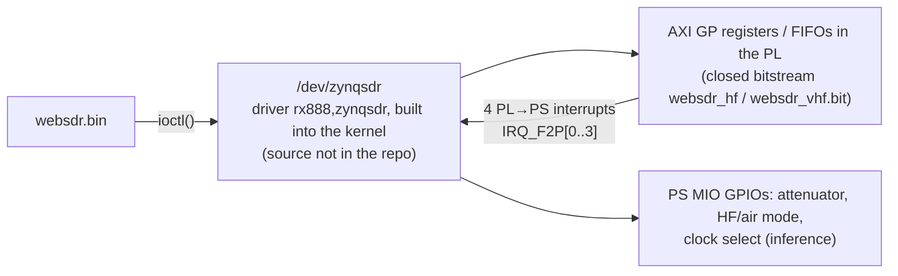

# Web-888 server <-> FPGA contract (from the RaspSDR/server source)

> **Clean-room boundary document.** This file records facts about the
> server ↔ FPGA/driver interface (ABI numbers, struct layouts, behaviour and
> bugs). It was written by reading the upstream server, including `zynq/`.
> Implementers of web888d's hardware layer use this file instead of
> the server's `zynq/` directory (see the web888d design, §12). Keep it free
> of copied code.

Source tree analysed: a RaspSDR/server snapshot from 2026-09 (the server matching firmware 20260919).
All `file:line` refs are relative to that directory unless they are absolute paths.
Where a statement is **inferred** rather than read directly from code, it is marked *(inference)*.

---

## 0. Executive summary: the contract has two layers

The server **never touches FPGA registers directly**. It has no `/dev/mem` mmap, no UIO, no udmabuf
in the production path. All FPGA access goes through one closed kernel driver:



That gives two possible ways to build a drop-in open FPGA:

* **A. Keep the closed kernel driver.** The new bitstream then has to match the driver's hidden register
  map exactly. The only evidence for that map in this repo is a stale test tool,
  `app/write-c2-files.c`, which mmaps `/dev/mem` at 0x40000000-0x47000000 (see §2.2). You would have to
  confirm it by disassembling the driver in the kernel image (`firmware-20260919/x/boot.bin`).
* **B. Replace the driver too (recommended).** Write an open `/dev/zynqsdr` driver that implements the
  ioctl ABI in §2.1 and talks to your own register map. The server needs no changes, and the ioctl ABI
  is fully specified by `zynq/ioctl.h` and `zynq/peri.cpp`.

**Since then (2026-10-28):** both were done. The stock driver was reverse-engineered
(`docs/stock-driver.md`), and the open bitstream (`fpga/`, release v0.2.0) implements its register
map: it runs on a stock unit with the stock driver (option A, `docs/hardware-test-plan.md`). An open
driver (option B, `driver/`) is complete in the emulator but not yet tested on hardware.

---

## 1. Bitstream loading

| Item | Detail | Ref |
|---|---|---|
| Mechanism | the server copies `/media/mmcblk0p1/websdr_<variant>.bit` into `/dev/xdevcfg` via a shell command. This is the legacy Xilinx devcfg char device. The DT has an `fpga-full` fpga-region / fpga-manager, but the server does not use it. | `zynq/peri.cpp:111` |
| File select | `use_13ch = kiwi.airband \|\| ADC_CLOCK_NOM < 100 MHz`: `websdr_vhf.bit` if true, otherwise `websdr_hf.bit` | `zynq/peri.cpp:108-111` |
| When `vhf` is chosen | airband mode (ADC 98.304 or 110.592 MHz), or "narrowband" mode (ADC = 122.88/2 = 61.44 MHz) | `init/clk.cpp:159-186` |
| Failure handling | a failed load is fatal (the server panics) | `zynq/peri.cpp:112-114` |
| Order | Si5351 is programmed **before** the bitstream loads (ADC clock running first). `/dev/zynqsdr` is opened **after** the load. | `zynq/peri.cpp:47-121` |
| Version/ID checks | **None** on the bitstream itself. After loading, the server only reads `GET_SIGNATURE`, using nibble 0 = #RX and nibble 1 = #WF, and `GET_DNA` (Zynq device DNA, used as unit identity `net.dna`). No version or magic compare. | `zynq/peri.cpp:130`, `main.cpp:249-254,305` |
| Install path | `/media/mmcblk0p1` = SD card FAT partition. The init script `firmware-20260919/ovl/etc/init.d/sdrd` copies `websdr.bin` from there. | — |

### Binary / HDL files
* **In the server repo:** no `.bit`, `.bin`, `.bit.bin`, `.v`, `.sv`, `.vhd`, `.tcl`, `.xdc`, `.xpr`, `.dts`, `.dtb` or `.ko` files at all (`find` over the whole tree). **No HDL or Vivado project exists in the repo.**
* **In the official firmware release** `web-888-alpine-3.20-armv7-20260919.zip` (outside the server repo, listed for completeness):

| Path | Size | Notes |
|---|---|---|
| `x/websdr_hf.bit` | 1,244,764 B | md5 83d3bc65…; header: `system_wrapper;COMPRESS=TRUE;UserID=0XFFFFFFFF;Version=2023.1`, part `7z010clg400`, built 2025/04/13 14:07:09 |
| `x/websdr_vhf.bit` | 1,249,832 B | md5 ca670223…; same header, 2025/04/13 14:21:08 |
| `x/boot.bin` | 9,056,768 B | contains `rx888,zynqsdr` string; the kernel is built in (driver not a module) |
| `x/modloop` | squashfs, kernel `6.6.110-xilinx`; **no zynqsdr .ko** (only pps-gpio etc.) |
| `boot.dts`, `dtb_1d780.dtb` | device tree (see §6) |

"system_wrapper" is the standard Pavel Demin red-pitaya-notes block-design top name, and the bitstream is a Vivado 2023.1 compressed `.bit` with a header.

---

## 2. Register map / driver ABI

### 2.1 The real (production) contract: `/dev/zynqsdr` ioctls

Opened `O_RDWR|O_SYNC`, `FD_CLOEXEC` (`zynq/peri.cpp:116-121`). Type char `'Z'` (0x5A). Computed ioctl
numbers are for 32-bit ARM (sizes come from the packed structs).

| ioctl | nr | number | arg | direction / meaning | server wrapper (file:line) | callers |
|---|---|---|---|---|---|---|
| `AD8370_SET` | 0 | 0x40045A00 | u32 **by value** | RF attenuation code = `-attn_dB*2` (0.5 dB steps; log says "PE4312", a 6-bit 0-31.5 dB step attenuator). Only applied for attn ≤ 0. | `rf_attn_set` `zynq/peri.cpp:136-148` | `rx/rx_sound_cmd.cpp:288`, init `peri.cpp:128` |
| `MODE_SET` | 1 | 0x40045A01 | u32 by value | 0 = HF, 1 = airband (RF path switch) | `rf_enable_airband` `peri.cpp:150-156` | `peri.cpp:125` |
| `CLK_SET` | 2 | 0x40045A02 | u32 by value | 0 = external ADC clock, 1 = internal (Si5351) | `peri.cpp:122` | init |
| `GET_DNA` | 3 | 0x80085A03 | `u64*` | Zynq 57-bit device DNA | `fpga_dna` `peri.cpp:227-235` | `main.cpp:305` |
| `RX_START` | 4 | 0x40045A04 | u32 by value | start RX DDC; arg = `fpga_rx_decim` (see §4) | `fpga_start_rx` `peri.cpp:237-241` | `rx/data_pump.cpp:217` (once, at init) |
| `RX_PARAM` | 5 | 0x400C5A05 | `struct {u32 channel; u64 freq;}` packed | set RX channel NCO; freq = phase increment scaled by 2^48 (§4) | `fpga_rxfreq` `peri.cpp:243-249` | `rx/rx_sound_cmd.cpp:147`, `rx/rx_sound.cpp:340` |
| `RX_READ` | 6 | 0xC00C5A06 | `struct {u32 address; u32 length; u32 readed;}` | copy up to `length` bytes of interleaved RX samples to user VA `address`. Returns bytes copied in `readed` (may be short, non-blocking). Server loops, sleeping 10 ms, until done. | `fpga_read_rx` `peri.cpp:251-275` | `rx/data_pump.cpp:69` |
| `SET_GPIO_MASK` | 7 | 0x40045A07 | u32 by value | write GPIO word (bits below) | `peri.cpp:307,326` | |
| `GET_GPIO_MASK` | 8 | 0x80045A08 | `u32*` | read back GPIO word (read-modify-write) | `peri.cpp:300,317` | |
| `GET_SIGNATURE` | 9 | 0x80045A09 | `u32*` | bits[3:0] = #RX channels, bits[11:8] = #WF channels; other bits unused by SW | `fpga_signature` `peri.cpp:346-354` | `main.cpp:249-254`, `peri.cpp:130` |
| `WF_START` | 10 | 0x40045A0A | u32 by value | (re)start capture on WF channel; bit16 `WF_READ_CONTINUES` is meant to request continuous mode, **but see bug** | `fpga_reset_wf` `peri.cpp:364-379` | `rx/rx_waterfall.cpp:880,906,927` |
| `WF_PARAM` | 11 | 0x400C5A0B | `struct {u16 channel; u16 decimate; u64 freq;}` packed | WF NCO (2^48 scaled) and CIC decimation (power of 2) | `fpga_wf_param` `peri.cpp:381-389` | `rx_waterfall.cpp:289,407,446,905,926` |
| `WF_READ` | 12 | 0xC00E5A0C | `struct {u16 channel; u32 address; u32 length; u32 readed;}` packed (14 B) | copy WF IQ samples; short reads allowed, server retries every 1 ms | `fpga_read_wf` `peri.cpp:427-450` | `rx_waterfall.cpp:909,920,929` |
| `PPS_START` | 20 | 0x40045A14 | u32 by value (=1) | enable PPS ADC-tick counter | `fpga_start_pps` `peri.cpp:277-281` | `gps/gps.cpp:147` |
| `PPS_READ` | 21 | 0x80045A15 | `u32*` | number of ADC clocks between the last two PPS edges. `-EBUSY` means no new PPS, and the server treats it as 0/skip. | `fpga_read_pps` `peri.cpp:283-296` | `gps/gps.cpp:153` (polled 1/s) |

Header definitions: `zynq/ioctl.h:7-67`.

**GPIO word (`SET/GET_GPIO_MASK`)**, `zynq/peri.h:5-16`:

| bit | name | meaning | set by |
|---|---|---|---|
| 0-5 | `GPIO_ANTENNA0..5` | antenna switch outputs (one-hot from the ant_switch ext, or toggled; 0 = all grounded) | `extensions/ant_switch/ant_switch.cpp:41-73` -> `fpga_set_antenna` `peri.cpp:298-313` |
| 6 | `GPIO_DITHER` | LTC2208 DITH pin *(inference: pin name)* | `rx/rx_init.cpp:384`, `ui/admin.cpp` (SET dither=) |
| 7 | `GPIO_PGA` | LTC2208 PGA pin (gain range) | `rx/rx_init.cpp:382`, `ui/admin.cpp` (SET pga=) |
| 8 | `GPIO_LED` | front LED | `zynq/leds.cpp:71` |

Bug: `GPIO_ANNENNA_MASK` is 0x7F (`peri.h:12`), so any antenna change also **clears the dither bit**.

**Stubbed / not implemented (no FPGA requirement today):**
* `fpga_setovmask()` (ADC overflow count mask, `rx/rx_server.cpp:163-164` sends 0xFC00, `ui/admin.cpp` "SET ov_counts") is an empty TODO at `peri.cpp:356-358`.
* `fpga_setadclvl()` (ADC level counter, `rx/rx_server_ajax.cpp:479-502`) is an empty TODO at `peri.cpp:360-362`. `adc_count` is always 0.
* `dpump.rx_adc_ovfl` is never set, so `SND_FLAG_ADC_OVFL` (`rx/rx_sound.cpp:1274`) is never raised. **There is no ADC-overflow path from the FPGA.**

**Bugs worth knowing for a reimplementation:**
* `fpga_reset_wf` builds `data = wf_chan | WF_READ_CONTINUES` but passes `wf_chan` to the ioctl (`peri.cpp:366-372`). The driver **never sees the continuous flag** (and would ignore it: the stock driver always selects one-shot, `docs/stock-driver.md`). Overlapped sampling (`rx_waterfall.cpp:913-921`) still issues repeated `WF_READ`s without a new `WF_START`, so the driver/FPGA must keep streaming after `WF_START` *(inference)*.
* `RX_PARAM.channel` is filled with `(__u8)rx_chan` (`peri.cpp:245`).
* `test-driver.cpp:35` passes `&int_clk` (pointer) to `CLK_SET`; production passes the value. Implement as **by value**.

### 2.2 Historic direct register map (only evidence of the PL-side layout)

`app/write-c2-files.c` is not built (CMake globs don't include `app/`). The name is borrowed from Pavel Demin's
`sdr_transceiver_wspr` app. It mmaps `/dev/mem` directly and is the only place in the repo showing PL
addresses. Its frequency format (30-bit phase relative to a **125 MHz** ADC, `MAKE_FREQ` at line 74) is
Red-Pitaya-era and **does not match** the current 2^48 / 122.88 MHz ABI. Treat it as a design hint, not as ground truth.

| Region (phys) | Map size | R/W | Struct / meaning | Ref |
|---|---|---|---|---|
| 0x4000_0000 | 1 page | RW | `FPGA_Config` (cfg register, axi_cfg_register style) | `app/write-c2-files.c:30-38,94` |
| 0x4100_0000 | 1 page | R | `FPGA_Status` (sts register) | `:40-47,95` |
| 0x4200_0000 | 2 pages | R | RX sample FIFO read port (every read pops one 32-bit word) | `:96,136-154` |
| 0x4300_0000 + n*0x0100_0000, n=0..3 | 1 page each | R | WF n FIFO read port (0x43,0x44,0x45,0x46…) | `:98-100` |
| 0x4700_0000 | 1 page | R | PPS FIFO read port | `:102` |

`FPGA_Config` (packed):

| Offset | Field | Bits / meaning |
|---|---|---|
| 0x00 | `reset` | bit0 `RESET_RX`; bits1-4 `RESET_WF(n)`; bit7 `RESET_LEDON`; bit8 `RESET_PPS` (`:19-23`). Tool writes 0 and then 0xFF (active-low resets *(inference)*). |
| 0x04-0x40 | `rx_freq[16]` | u32 phase increment per RX channel (old: `f/125MHz*2^30`) |
| 0x44-0x60 | `wf_config[4]{wf_freq, wf_decim}` | u32 NCO + u32 decimation (tool uses `1<<(i+3)`) |
| 0x64 | `gpios` (u8) | bit0-5 antenna, bit6 dither, bit7 PGA (`:25-28`) |

`FPGA_Status` (packed):

| Offset | Field | Meaning |
|---|---|---|
| 0x00 | `signature` | [3:0] #RX, [11:8] #WF (same as the current `GET_SIGNATURE`) |
| 0x04 | `rx_fifo` | RX FIFO fill level (words or frames; tool waits for ≥500) |
| 0x08-0x14 | `wf_fifo[4]` | WF FIFO fill levels |
| 0x18 | `pps_fifo` | PPS FIFO fill level |
| 0x1C | `fpga_dna` (u64) | device DNA |
| 0x24 | `tsc` (u64) | free-running timestamp counter *(inference: ADC-clock ticks)* |

Old RX FIFO framing (`:143-153`): per output sample, **one 32-bit tick word**, then `I,Q` (s32 each) for each
of `rx_channels` channels. The current server expects **no** tick word (§3), so either the driver strips it or the
current FPGA no longer emits it.

---

## 3. Data movement (RX and WF)

There is **no AXI-DMA, udmabuf, CMA or reserved-memory usage** visible anywhere in the server or the DT (no
`reserved-memory` node, no `cma=` in bootargs, and the `zynqsdr` DT node has no `reg` and no dma properties).
The server hands the driver a **user virtual address** (`address` field, u32) and the driver copies into it.
Partial copies are allowed and the server polls. Together with the old FIFO-port design (§2.2), this strongly suggests the
driver drains PL FIFOs through AXI GP reads (possibly interrupt-driven with the 4 PL IRQs) and `copy_to_user`s
the result *(inference)*. Bandwidth is small: 13 ch × 2 × 4 B × 12 kS/s ≈ 1.25 MB/s for RX.

### 3.1 RX audio channels
| Property | Value | Ref |
|---|---|---|
| # channels | `signature & 0xF` (max 15 by nibble; `MAX_RX_CHANS`=16) | `main.cpp:250`, `config.h:33` |
| Read size | `sizeof(s32) * 2 * rx_chans * nrx_samps`, `nrx_samps` = `MAX_NRX_SAMPS` = 512. For 13 ch that is 53,248 B per call. | `rx/data_pump.cpp:69`, `config.h:36-37` |
| Format | little-endian **s32 I, s32 Q**, interleaved by channel, frame-major: `[ch0.I ch0.Q ch1.I ch1.Q … chN-1.Q][next sample]…` | `rx/data_pump.cpp:71-83` |
| Scaling | `RXO_BITS`=31, `RXOUT_SCALE`=30, rescale = 2^(−30+15). An s32 value of ±2^30 is full scale (= ±32768 in CuteSDR units), leaving 1 bit of headroom. | `zynq/kiwi.gen.h:15`, `kiwi.h:35-40`, `data_pump.cpp:48` |
| Headers/timestamps | **None.** `rx->ticks[] = 0` is hard-coded, so GPS timestamps in IQ/TDoA packets are effectively unsupported (`rx_sound.cpp:530-531` uses `time_diff48(ticks, clk.ticks)`, which expects a 48-bit ADC-tick counter). An FPGA that supplied a 48-bit sample timestamp could revive this. | `rx/data_pump.cpp:93` |
| I/Q polarity | Uses I=word0, Q=word1 directly. The Kiwi comment about reversed I/Q is retained, but no swap is done. | `data_pump.cpp:78-81` |
| Software DC offset | `DC_offset_I/Q` added after scaling | `rx/rx_init.cpp:192-209` |
| Pacing | Blocking-ish: the data-pump task loops on `RX_READ` with 10 ms sleeps. Sample rate is entirely FPGA-paced. | `peri.cpp:251-275` |
| Start | single `RX_START(fpga_rx_decim)` at server init; never stopped/restarted | `data_pump.cpp:215-218` |

### 3.2 Waterfall channels
| Property | Value | Ref |
|---|---|---|
| # HW channels | `(signature>>8) & 0xF`. In `wf_share` mode they are pooled via a semaphore, with at most **4** slots (`wf_using[4]`). Otherwise RX channel *k* < wf_chans uses WF channel *k*. | `peri.cpp:40,130-131,391-425`, `rx_waterfall.cpp:245` |
| Frame | 8192 complex samples (`WF_C_NSAMPS` = 1024·2·2·2), i.e. 32 KiB per frame. "hardware sample buffer length limitation" ≤ 8192. | `rx/rx_waterfall.h:50-56`, `rx_waterfall.cpp:175` |
| Format | `struct iq_t {s16 i; s16 q;}` packed LE, so in a 32-bit word I = [15:0] and Q = [31:16]. Full scale ±32768 (window scale 2^−16 gives ±0.5). | `rx_waterfall.h:59-61`, `rx_waterfall.cpp:124,934-949` |
| Non-overlapped sequence | `WF_PARAM(ch, decim, freq)`, then `WF_START(ch)`, then `WF_READ(ch, 32 KiB)` (polls 1 ms until complete). The FPGA must therefore buffer ≥ 8192 samples **captured after the restart**. At decim=1 that is a burst at the full ADC rate (122.88 MS/s), which needs a BRAM capture buffer per channel (≥ 32 KiB). | `rx_waterfall.cpp:923-930` |
| Overlapped sequence | when the frame time ≥ half the display period: one `WF_START`, then repeated `WF_READ`s of *n* < 8192 samples appended to a sliding window. Requires continuous streaming at the decimated rate. | `rx_waterfall.cpp:869-881,913-921` |
| wf_share | `fpga_get_wf` → `WF_PARAM` → `WF_START` → `WF_READ` → `fpga_free_wf` per frame | `rx_waterfall.cpp:899-911` |

### 3.3 PPS
`PPS_START(1)` once, then `PPS_READ` polled every 1 s. The returned u32 is used directly as "ADC clocks per GPS second"
(`init/clk.cpp:245-260`: `new_adc_clock = ticks / 1.0`) and accepted within a ±100 ppm window (first) or ±1 ppm window.
Separately, the GPS PPS pin also feeds the PS through **EMIO GPIO 54** for the kernel `pps-gpio` → chrony (§6).

---

## 4. DDC parameters

### 4.1 Clocks and rates
| Mode | ADC clock (Si5351 CLK0) | bitstream | Ref |
|---|---|---|---|
| HF (default) | 122.88 MHz (`ADC_CLOCK_HF`) | hf | `init/clk.h:29`, `clk.cpp:183` |
| narrowband | 61.44 MHz | vhf | `clk.cpp:184-185` |
| airband profile 0 | 98.304 MHz (PLL 786.432 MHz /8) | vhf | `clk.cpp:48-57` |
| airband profile 1 | 110.592 MHz (PLL 663.552 MHz /6) | vhf | `clk.cpp:58-66` |

Audio rate `snd_rate = 12000*(1+idx)`. The admin UI offers idx 0..2 = 12/24/36 kHz (`web/kiwi/admin.js` `c_rates`),
and HF code allows idx up to 3 (48 kHz) (`main.cpp:236-256`). Airband 36 kHz forces the 110.592 MHz profile.

### 4.2 RX decimation (`RX_START` argument)
```
HF/narrowband: rx_decim = (int)(ADC/snd_rate); fpga_rx_decim = rx_decim/256      (main.cpp:267-270)
airband:       fpga_rx_decim = ADC/(snd_rate*256) (must divide exactly); rx_decim = fpga_rx_decim*256 (main.cpp:257-266)
```
So **total FPGA decimation = fpga_rx_decim × 256**, made of one fixed ×256 stage and one variable stage.

| ADC | 12k | 24k | 36k | 48k |
|---|---|---|---|---|
| 122.88 MHz | 40 | 20 | **13** (3413/256, non-integer) | 10 |
| 61.44 MHz | 20 | 10 | 6 (non-integer) | 5 |
| 98.304 MHz | 32 | 16 | n/a | n/a |
| 110.592 MHz | 36 | 18 | 12 | n/a |

Note: for HF at 36 kHz the software assumes `srate = ADC/rx_decim = ADC/3413` (`extensions/ext.cpp:57`), but the FPGA
gets 13 (×256 = 3328), which gives a 36.92 kHz output. That is a rate mismatch unless the FPGA does something non-obvious.
The variable stage must support R ≈ 5..40.

CIC structure (from `tools/CICF.py`, the compensation-fit script): stage A **N=3, R=256, M=1** and stage B
**N=5, R=10..40, M=1** (`SampleRate = 122.88 MHz/(256·R2)`). Software compensation uses a sinc^-5 droop model,
so the CIC stage at the output rate has order 5: `m_CIC_coeffs = sinc(f)^-5 + p1·exp(p2(f-0.5))`, with p1/p2 =
(−1.9134, 45.625) at 12 kHz and (−0.1003, 41.5667) otherwise (`rx/CuteSDR/fastfir.cpp:68-74,131-138`).
This compensation is applied inside the passband FFT FIR. There is **no evidence of an FIR compensation filter in the FPGA**.
The audio passband filtering is done entirely in software (`CFastFIR`). `OPTION_EXPERIMENT_CICF` is a disabled alternative.

### 4.3 NCO (RX and WF)
```
RX:  i_phase = round( f_Hz / adc_clock_corrected * 2^48 )            (rx/rx_sound_cmd.cpp:141-147, rx_sound.cpp:334-340)
     with spectral inversion: f' = ADC/2 - f
WF:  i_offset = (u64)( off_freq_Hz / adc_clock_corrected * 2^48 )    (rx/rx_waterfall.cpp:282-289, 432-446)
```
* The word is **48-bit unsigned fraction-of-fs** carried in a u64. Range 0..fs/2 (`ui_srate = ADC/2`, `rx/rx_init.cpp:143`). The driver probably truncates it to the FPGA phase width *(inference)*.
* `adc_clock_corrected` is GPS-disciplined (§5), so NCO words are rewritten whenever the clock estimate changes (`rx_sound.cpp:329-340`, `rx_waterfall.cpp:280-292`).
* Airband undersampling is handled purely by the software frequency offset (`init/clk.cpp:98-123`). The FPGA just sees the NCO word.
* The NCO is the **left edge** of the waterfall span, not the centre. The band of interest after mixing is 0..+fs_out/4 (see below), which implies the mixer shifts by −f_NCO *(inference from bin usage)*.

### 4.4 Waterfall zoom → decimation
```
zm1 = zoom ? zoom-1 : 0;  r1 = zm1;  decim = 1 << r1        (rx/rx_waterfall.cpp:368-387)
zoom 0..14 (wf_share: 0..11)  =>  decim = 1,1,2,4,...,8192  (hardware limit r1 <= 15)
samp_wait_us = 8192 * decim / ADC * 1e6                      (:389)
```
* zoom 0: decim 1, NCO=0, uses FFT bins 0..4095 (0..fs/2).
* zoom ≥ 1: uses only the first quarter of the 8192-bin FFT (`fft_used = 8192/2/2`, `:678-681`) to avoid CIC alias images. Displayed span = fs/2^(zoom+1) = fs_out/4.
* Decimating filter: **CIC N=5**, R up to 8192 (`tools/CICF.py` "WF CICF" N1=5 R1=8192). Software droop correction `CIC_comp = 0.5 + (sinc^-5 + p1 e^{p2(f-.5)})/2` with p1=−1.3137, p2=44.8742 (`rx_waterfall.cpp:159-171`). Bit growth for N=5, R=8192 is 65 bits.

---

## 5. Other FPGA / board functions

| Function | Implementation | Ref |
|---|---|---|
| Si5351 | PS I2C bus 0 (`/dev/i2c-0`, `i2c@e0004000`), addr 0x60. CLK0 = ADC clock, 8 mA. CLK2 = optional GPSDO/ext output (`ext_ADC_freq`). The PLL ref is `fw_printenv refclock` (default 24.576 MHz) or 10 MHz if ext. **Not via FPGA.** The bus also carries the 24c64 EEPROM (MAC) used at kernel boot, so it is on MIO pins, not EMIO *(inference)*. | `zynq/peri.cpp:31-106`, `si5351/i2c.cpp:43`, `zynq/stub.cpp` (`eeprom_refclock`) |
| GPS-disciplined clock | PPS tick count → moving average → `adc_clock_corrected`. Optional `gps_corr`: a PID loop (Kp 1.4, Ki 0.15, Kd 0.01) trims the Si5351 PLL via `set_correction()`. The FPGA PPS counter is the feedback sensor. | `init/clk.cpp:245-310`, `zynq/peri.cpp:181-221` |
| GPS PPS counter | `PPS_START`/`PPS_READ` (§3.3). Needs a 32-bit counter of ADC clocks latched on each PPS rising edge, plus a "new value" flag (the driver returns EBUSY otherwise). | `gps/gps.cpp:146-160` |
| GPS data | gpsd over UART (not FPGA) | `gps/gps.cpp:164-172` |
| ADC overflow / clip | **not implemented** (stubs) | §2.1 |
| Dither / PGA | GPIO bits 6/7 (LTC2208 pins) | §2.1 |
| Attenuator | `AD8370_SET` ioctl (0.5 dB code, PE4312). The DT gives the driver MIO GPIOs 10-13 + 49 (see §6), so the attenuator is probably bit-banged from PS MIO, not PL *(inference)*. `app/test_vga.c` holds the AD8370 VGA gain table from the RX-888 heritage. | `peri.cpp:136-148` |
| HF/air RF switch, ext/int clock select | `MODE_SET`, `CLK_SET` ioctls (likely MIO GPIO, *inference*) | `peri.cpp:122,150-156` |
| Antenna switch | GPIO bits 0-5, 6 ports | `extensions/ant_switch/ant_switch.cpp:24-73` |
| LED | GPIO bit 8, a single LED (`led_set_one` ignores the index) | `zynq/leds.cpp:66-72` |
| Fan / temperature / XADC | **none** in server code | grep |
| ADC clock counting | only via the PPS counter | — |
| Wideband/IQ streaming | only the RX path at up to 48 kHz; no separate wideband DDC. `pkgs/sdrpp_server` and the IQ extension consume the normal RX channels. | — |
| HPSDR (`hpsdr/hpsdr.cpp`) | **Dead code**: not in the CMake globs (`CMakeLists.txt` KIWI_SRCS), and it calls `fpga_start_rx(48000)` etc., which doesn't match the current zero-arg API. It also passes raw Hz to `fpga_rxfreq`. It would need RX at 48/96/192/384 kHz (`:173-199`) and up to 7 receivers (Hermes protocol 1, port 1024). | `hpsdr/hpsdr.cpp:106-320` |
| Red Pitaya variant | None in the server: only `PLATFORM_ZYNQ7010` (`kiwi.h:43`, `main.cpp:108`). The RP heritage shows in `write-c2-files.c` (125 MHz) and `tools/run.sh` mounting `../rx888/red-pitaya-notes` into the build chroot. | |
| Native harness | `native/peri.cpp` is a fake implementing the same `fpga_*` API. It confirms the formats: RX s32 interleaved I/Q at ±0.18·2^31, WF s16 I/Q, signature = rx \| wf<<8. | `native/peri.cpp:72-92,127-130,175-191` |

---

## 6. Device tree / kernel bits

* **In the server repo:** none (no dts, overlays or kernel sources). `AGENTS.md` lists `/dev/zynqsdr` and `/dev/xdevcfg` as runtime requirements.
* **From `firmware-20260919/boot.dts` (outside the repo):**

```dts
fpga-full { compatible = "fpga-region"; fpga-mgr = <&devcfg>; ranges; };   // unused by server
devcfg@f8007000 { compatible = "xlnx,zynq-devcfg-1.0"; ... clock-names = "ref_clk","fclk0".."fclk3"; };
gpio@e000a000 { compatible = "xlnx,zynq-gpio-1.0"; emio-gpio-width = <1>; gpio-mask-low = <0x5600>; };
pps { compatible = "pps-gpio"; gpios = <&gpio 54 0>; capture-clear; };       // GPIO 54 = EMIO[0]  => PL must route PPS pin to EMIO GPIO 0
zynqsdr {
    compatible = "rx888,zynqsdr";
    interrupt-parent = <&gic>;
    interrupts = <0 29 1>, <0 30 1>, <0 31 1>, <0 32 1>;   // SPI 29..32 = GIC ID 61..64 = IRQ_F2P[0..3], rising edge
    gpios = <&gpio 10 1>, <&gpio 13 1>, <&gpio 12 1>, <&gpio 11 1>, <&gpio 49 1>;  // PS MIO 10-13, 49 (active-low flag)
};   // NOTE: no reg => driver hard-codes PL physical addresses
```
* chrony uses `/dev/pps0` (pps-gpio) plus gpsd SHM (`ovl/etc/chrony/chrony.conf`).
* Kernel `6.6.110-xilinx`. The zynqsdr driver is **built in** (not in modloop). Its strings sit in `x/boot.bin`, but the kernel image appears compressed, so the register offsets can't be seen there with `strings`.

**FPGA-side requirements implied by the DT:** 4 interrupt outputs to IRQ_F2P[3:0] (edge), 1 EMIO GPIO input (PPS),
and AXI GP0 slave(s) at fixed addresses (historically 0x4000_0000-0x47FF_FFFF).

---

## 7. References to the FPGA project / provenance

| Evidence | Where |
|---|---|
| `tools/run.sh:7-9` bind-mounts `../rx888/red-pitaya-notes` into the Alpine build chroot (next to `../rx888/web-888/server`). The FPGA is evidently built from a (private) fork of Pavel Demin's red-pitaya-notes. | `tools/run.sh` |
| `app/write-c2-files.c`: name and style (cfg/sts mmap, `MAKE_FREQ` with 125 MHz and 2^30) copied from red-pitaya-notes `sdr_transceiver_wspr` | `app/write-c2-files.c` |
| Bitstream header `system_wrapper`, Vivado 2023.1, xc7z010clg400 | `firmware-20260919/x/*.bit` |
| `_COPYRIGHT:222-223` "Xilinx (FPGA, Vivado, Verilog) (c) 1995-2020 Xilinx" (inherited from KiwiSDR) | `_COPYRIGHT` |
| CMake project name `RaspSDR`; DT compatible `rx888,zynqsdr`; crash paths `/root/ZynqSDR/Beagle_SDR_GPS/...` | `CMakeLists.txt:2`, `zynq/README.md` |
| `kiwi.gen.h` "DEFp 0x…" comments are KiwiSDR Verilog-generated header leftovers (ADC_BITS 16, RXO_BITS 31 (was 24), GPS_MAX_CHANS) | `zynq/kiwi.gen.h` |
| No git URLs, Vivado tcl or Pavel Demin names in the server sources | grep |

RaspSDR/red-pitaya-notes (default branch) is stock upstream (projects: sdr_receiver,
sdr_receiver_hpsdr, sdr_transceiver_*). It contains no web888/zynqsdr project, but its `sdr_receiver_hpsdr`
cores (axi_cfg_register, axi_sts_register, axis fifo readers, CIC, DDS) are the likely building blocks.

---

## 8. Minimum feature list for a drop-in FPGA (+ open driver, option B)

1. Device signature: #RX (≤15) in [3:0], #WF in [11:8]. Device DNA readout (DNA_PORT).
2. RX: N parallel DDCs on the 16-bit LTC2208 stream (with ADC clock = Si5351 CLK0, up to 122.88 MHz). Each has an NCO with ≥32-bit (ideally 48-bit) phase, quadrature mix, CIC decimation by `R×256`, R programmable 5..40 (one global setting), and s32 output with full scale ≈ 2^30. Output is one frame per output sample containing all channels' I/Q, streamed through a FIFO the driver can drain (~1.3 MB/s for 13 ch at 12 kHz, ~4 MB/s at 36 kHz).
3. WF: M channels (2 on the HF build per the brief; up to 4 in shared mode). Each has an NCO (same format), CIC N=5 decimation by 2^k (k=0..13, decim=1 is a bypass), s16 I/Q output, a restartable capture of ≥8192 samples (BRAM, needed for decim=1 bursts), and continuous streaming for overlapped mode.
4. PPS: 32-bit ADC-clock counter latched per PPS edge, with a new-data flag. Also route PPS to EMIO GPIO[0].
5. GPIO outputs: antenna[5:0], LTC2208 DITH, PGA, LED.
6. Interrupts to IRQ_F2P[3:0] as the driver needs (e.g. RX FIFO threshold, WF ready ×2, PPS).
7. Optional improvements the software already has hooks for: a 48-bit sample timestamp in the RX stream (`rx->ticks`, `rx_sound.cpp:530`), and an ADC overflow counter (`fpga_setovmask`, `fpga_setadclvl`, `SND_FLAG_ADC_OVFL`).
