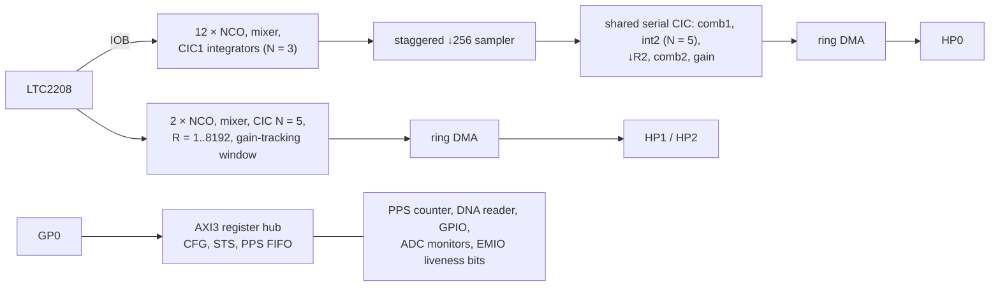

# Web-888 open FPGA

An open-source replacement for the closed `websdr_hf.bit` / `websdr_vhf.bit`
bitstreams of the Web-888 SDR (Zynq XC7Z010-1CLG400 + LTC2208 16-bit ADC).

It implements the same hardware contract as the vendor design, so it runs
under the **stock firmware and stock `zynqsdr` kernel driver**: copy
`build/hf/websdr_hf.bit` over `/media/mmcblk0p1/websdr_hf.bit` and restart
the server. The contract was recovered from the open server code and the
driver (see `../docs/`), and is documented in `doc/register-map.md`.

**Status:** HF and VHF from release v0.2.0 (2026-10-28); v0.3.0 added
the channelizer, and its HF/VHF rebuilds (shared code changed) haven't
run on hardware yet. The HF bitstream runs on a
stock Web-888 with the stock driver (`../docs/hardware-test-plan.md`):
48 k frames/s, web888d with web users and FT8/FT4/WSPR skimmers for an
hour. The VHF bitstream is simulated and timing-clean, not yet run on
hardware. v0.1.0 hung the board (its bus reset came from FCLK_RESET0_N,
which the PS holds while fclk0 is gated; now a PL power-on counter).

`rtl/fft/` holds the channelizer, a third bitstream (`websdr_pfb.bit`,
`make pfb`, released in v0.3.0; `../docs/channelizer.md`): the whole HF
band in 30 kHz bins, a power line and a tuner for 32 receivers. It is
not stock-compatible (web888d's bins mode, the open driver) and has run
on the project's unit since 2026-10-29.

## Architecture

Everything runs in the ADC clock domain (122.88 MHz on HF):



| block | file | notes |
|---|---|---|
| top (BD module reference) | `rtl/web888_core.v` | ports, register decode, status |
| clocking, reset | `rtl/clk_gen.v`, `rtl/web888_core.v` | IBUFDS → zero-delay PLL → BUFG; HF/VHF variants. Bus reset from a power-on counter, never from FCLK_RESET0_N |
| NCO | `rtl/nco.v` | 48-bit phase, quarter-wave ROM + Taylor correction |
| RX front end | `rtl/rx_frontend.v` | 12 ch (hf) / 13 ch (vhf), as stock, CIC1 N=3 R=256, Hogenauer-pruned |
| RX back end | `rtl/rx_serial_cic.v`, `rtl/cic_serial_stages.v` | all 24 paths share one pipeline (LUTRAM state) |
| RX framing | `rtl/rx_chain.v` | `{Q,I}` per channel per sample |
| waterfall | `rtl/wf_ddc.v` | variable-rate CIC with exact power-of-two gain normalisation |
| DMA | `rtl/axi_ring_writer.v` | 16-beat AXI3 bursts into a ring, ≤ 8 outstanding |
| registers | `rtl/axi_regs.v` | byte-strobe CFG, STS, PPS FIFO pop |
| PPS | `rtl/pps_counter.v` | clocks per PPS period → FIFO |
| DNA | `rtl/dna_reader.v` | 57-bit device DNA |
| liveness | `rtl/web888_core.v` | PLL lock, clock heartbeats and reset state on EMIO GPIO, readable from the PS without the PL's bus (`../tools/slcr-peek`) |
| channelizer (not in the bitstream) | `rtl/fft/` | polyphase FIR, radix-2² FFT, split; `../docs/channelizer.md` |

Design choices vs. the vendor bitstream (which uses Xilinx DDS/CIC IP):
plain Verilog only (simulates with Icarus, no IP licences), one shared
time-multiplexed pipeline for everything after the first ×256 decimation,
DSP48s only for mixers, NCO correction and one gain multiplier.

Vivado 2026.1 implementation (HF build, xc7z010-1, 12 RX): **11.9 k LUT (68 %)**,
12.6 k FF (36 %), 57 DSP (71 %), 12.5 BRAM36 (21 %). Timing is met at 125 MHz
with 0.4 ns of extra setup uncertainty as guardband (WNS +0.058 ns, so
effectively 131.6 MHz, +7 % over the 122.88 MHz ADC clock). VHF build (13 RX):
70 % LUT, 76 % DSP, 13 BRAM36, met at 111 MHz with a 0.5 ns guard (WNS +0.929 ns,
v0.2.0). Vendor design: 84 % LUT, 72 % FF, 75 % DSP, 55 % BRAM.

## Simulation results (`make sim`)

| test | result |
|---|---|
| NCO | 130 dB SFDR |
| register interface | signature, DNA, GPIO, byte-wise/unaligned CFG writes, PPS period: pass |
| RX, 3 channels, R2=5 (96 kHz) | tone frequency/sign exact, level within 0.001 dB of model, 116–122 dB SNR |
| WF0 continuous, R=4 | 4 components (incl. images, CIC droop, aliasing) within 0.001 dB, residual = 16-bit quantisation |
| WF1 one-shot, R=1 (122.88 MS/s) | exactly 256 bursts, no FIFO overflow with randomised HP backpressure |
| AXI | no protocol errors (memory models check burst shape, WLAST, W-before-AW, 4 KB) |
| bus reset | the testbench keeps `ps_resetn` low throughout, as on a stock unit with fclk0 gated |
| channelizer (`sim-fft`, `sim-split`, `sim-fir`, `sim-chain`) | each block and the whole chain bit-exact to the fixed-point model (two frames) |

## Usage

```sh
make sim          # Icarus Verilog (PATH or local.mk) + numpy analysis
make hf vhf       # Vivado (PATH or local.mk; see doc/vivado-notes.md)
make ci           # both bitstreams on the project's CI runner -> build/ci/
make pfb          # the channelizer datapath alone, out of context (Vivado)
```

CI (`.github/workflows/fpga.yml`): simulation on every change under
`fpga/`; bitstreams with a timing gate (WNS >= 0, with the guardband) on
the project's self-hosted Vivado runner for pushes to `main` and manual
runs, then the channelizer out of context (reported, not gating); tags
`v*` publish the bitstreams as a release with `SHA256SUMS`, with
`../docs/release-notes/<tag>.md` as the notes.

`make tables` regenerates the NCO ROM and RX gain table in `rtl/gen/`
from `scripts/gen_tables.py`. The channelizer's tables there
(`pfb_*.mem`) come from the server repo's fixed-point model
(`cargo run --release -p web888-dsp --example pfbvectors -- DIR`).

## On hardware (HF, v0.2.0, 2026-10-28)

What the first runs settled, from the list kept before them:

1. **HP port width:** 64-bit works with the vendor FSBL's AFI setup (the
   RX and WF data arrive intact).
2. **DNA bit order:** matches the vendor's. The stock driver's genuine
   check (eth0 MAC = hash(DNA)) would stop the data after about ten
   minutes otherwise; it ran for an hour.
3. **ADC format and timing:** offset binary and the IOB capture are
   right: FT8 decodes as on the stock bitstream.
4. **Sideband and scale:** USB is right (FT8 decodes at the right audio frequencies).
   The S-meter level against the vendor bitstream is not compared yet.

Learnt the hard way: the PL must not take a reset from FCLK_RESET0_N.
The stock kernel leaves fclk0 gated, and the PS then holds that reset
asserted, so the bus never answered and the first register access hung
the board (watchdog reset).

## Licence

GPL-3.0-or-later, see `../COPYING`. `cfg/ps7_preset.xml` comes from red-pitaya-notes
(MIT, Pavel Demin, see `cfg/LICENSE-red-pitaya-notes`; MIT is GPL-compatible).
